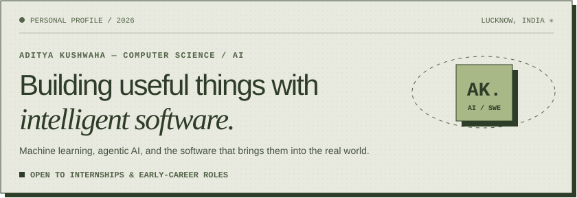
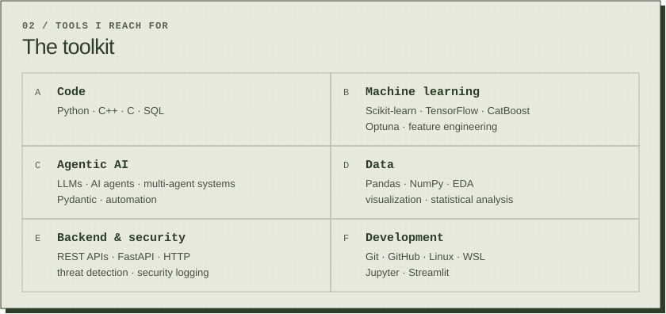
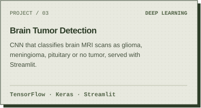
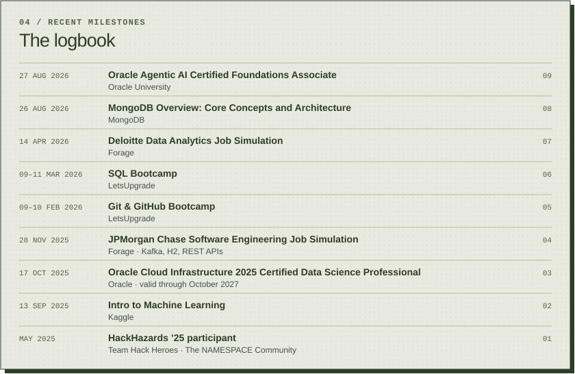

 

  

  

## Selected builds

▶ <a href="https://studentlifestyleandstressprediction-eyme6xuza6uzbh72mqn6rj.streamlit.app/">Try the Student Lifestyle &amp; Stress live demo</a>

  

  

## Open source

Merged pull request to **`wifi-observer`**: added unit tests and improved project reliability (`Python` · `Pytest` · `GitHub`).

## Competitive programming

Practising on [LeetCode](https://leetcode.com/u/AdityaKushwaha08/) and [HackerRank](https://www.hackerrank.com/profile/adityakushwaha02). Current goal: **500+ LeetCode problems**.

## Contribution snake

<picture>
  <source media="(prefers-color-scheme: dark)"  srcset="https://raw.githubusercontent.com/aditya00801/aditya00801/output/github-snake-dark.svg" />
  <source media="(prefers-color-scheme: light)" srcset="https://raw.githubusercontent.com/aditya00801/aditya00801/output/github-snake.svg" />
  
</picture>

  

🤝 <b>Open to internships and early-career roles in AI and software engineering</b>

 

© 2026 Aditya Kushwaha · Lucknow, India

