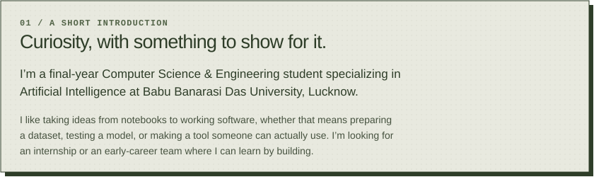
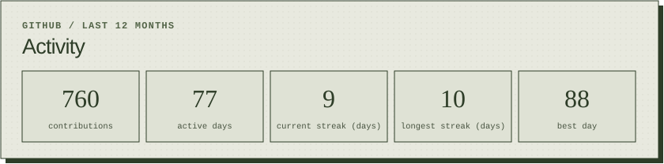
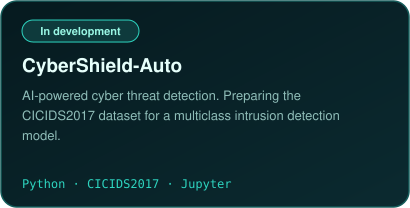
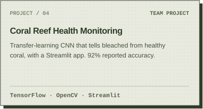
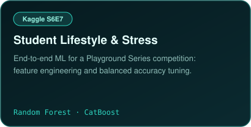
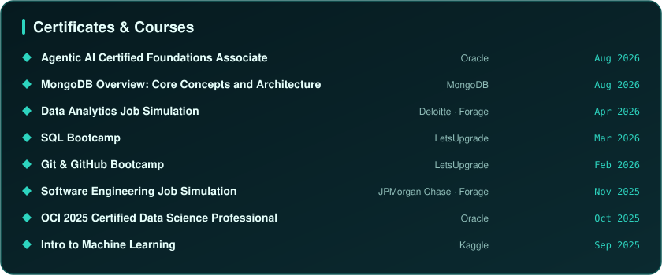

 

  

  

  

  

## 🚀 Featured Projects

## 🌍 Open Source

Merged pull request to **`wifi-observer`**: added unit tests and improved project reliability (`Python` · `Pytest` · `GitHub`).

## 🏅 Learning

## 🏆 Competitive Programming

Practising on [LeetCode](https://leetcode.com/u/AdityaKushwaha08/) and [HackerRank](https://www.hackerrank.com/profile/adityakushwaha02). Current goal: **500+ LeetCode problems**.

## 🐍 Contribution Snake

<picture>
  <source media="(prefers-color-scheme: dark)"  srcset="https://raw.githubusercontent.com/aditya00801/aditya00801/output/github-snake-dark.svg" />
  <source media="(prefers-color-scheme: light)" srcset="https://raw.githubusercontent.com/aditya00801/aditya00801/output/github-snake.svg" />
  
</picture>

  

🤝 <b>Open to collaborations on AI and security projects</b>

 

© 2026 Aditya Kushwaha · BBD University, Lucknow

